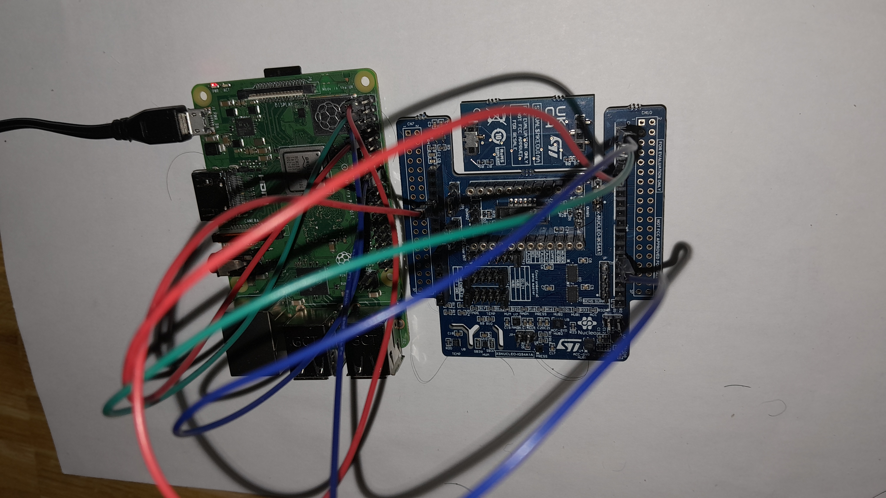
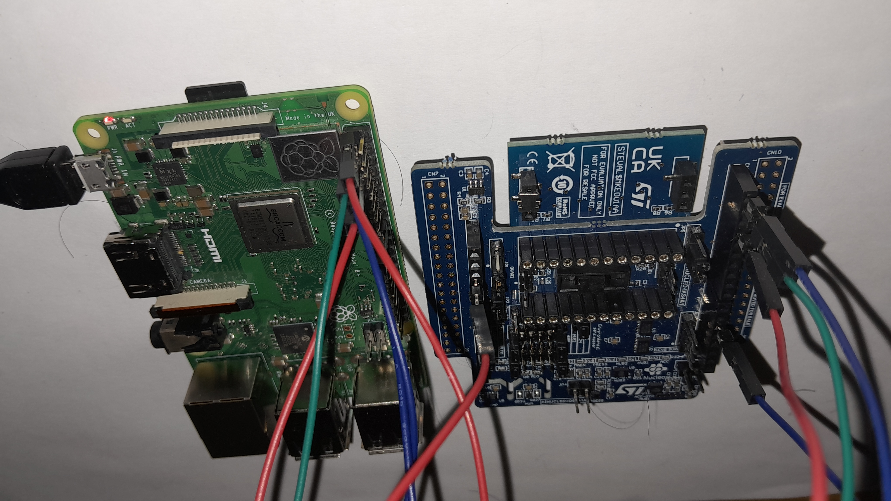
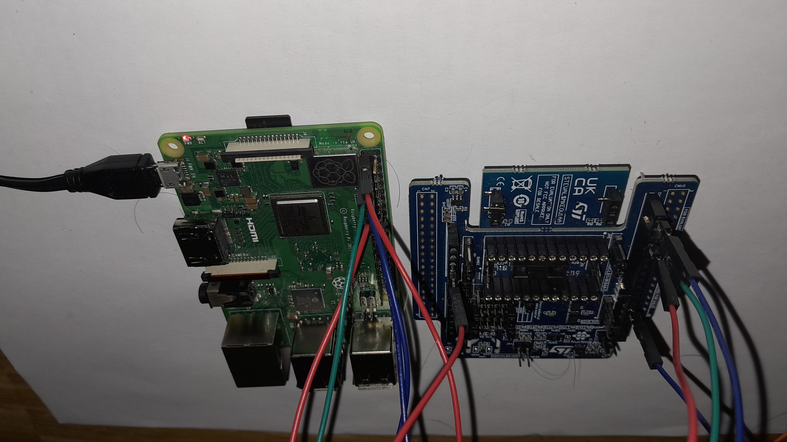

# The bench as it was wired for the measurements

Saturday 24 October 2026, 23:46 by the camera's clock, about three minutes
after the last of the nine runs in
[`../evidence/rates-2026-10-24.csv`](../evidence/rates-2026-10-24.csv).

Three photographs, named by the camera's timestamp rather than renamed,
because the time is the provenance:

## Why a photograph is part of the record

Bench state is not the record. A wiring table is an observation with a
date on it, never a standing fact, and this project has already paid for
treating one as the latter: project 5's design document carried a
seven-lead table headed "as built", copied from evidence six days older,
and by the time anyone looked there were four leads on the board.

So the rule is that a physical arrangement is photographed with the first
run after any change to it. These were taken with the runs still on
screen.

## What they establish

- **The shield is not stacked on a Nucleo.** It lies flat beside the Pi.
  That matters because the bus answered identically stacked and unstacked
  earlier the same day, and this is the configuration the numbers came
  from.
- **The Pi is powered from its own micro USB**, red PWR LED lit, and the
  shield is drawing from the Pi's 3.3 V rail through the leads rather
  than from any supply of its own.
- **Five flying leads**, red, pink, teal, blue and black, running from the
  shield's headers to the Pi's 40-pin header.
- **No breadboard anywhere in the path.** Every connection is a lead
  between two headers. This is worth stating because project 5's longest
  fault was a breadboard rail that turned out to be fed from a ground pin,
  and nothing of that shape can be present here.

## What they do NOT establish

**They do not verify the lead table.** Individual pin positions cannot be
read at this angle and resolution, and no attempt should be made to count
header pins from these images. The table below is what was reported at the
bench and what the overlay declares, not what was read off a photograph.
Anyone checking the wiring should check the hardware.

The five leads, from [`../hardware.md`](../hardware.md):

| Shield | Signal | Pi 3B+ header |
|---|---|---|
| CN6 pin 4 | 3.3 V | pin 1 |
| CN5 pin 7 | GND | pin 9 |
| CN5 pin 9 | I2C SDA | pin 3, GPIO2 |
| CN5 pin 10 | I2C SCL | pin 5, GPIO3 |
| CN9 pin 6 | LSM6DSV16X INT1 | pin 18, GPIO24 |

The interrupt lead is the one the FIFO path depends on, and GPIO24 is what
the overlay declares as `interrupts = <24 4>`, level high.

## An open question these raised

There is a second, smaller ST board in the stack, silkscreened something
like `STEVAL-SMKEOU1AA`, carrying `FOR EVALUATION ONLY`, `NOT FCC
APPROVED`, `FOR RESALE` and a UKCA mark. **Whether it is a DIL24
daughterboard seated on the IKS4A1 or an adapter the shield sits on is not
established here**, and the silkscreen is only partly legible in these
images.

It matters because anything on that bus can answer, and `0x19` has now
been seen in three states across three boots: absent from a plain
`i2cdetect`, present to a plain `i2cdetect`, and reported `absent` by
`iio-probe`'s bus column. That intermittency has no explanation yet, and
an extra board is the first thing to rule in or out. Reading the full part
number off the board by hand would settle what it is; `i2cdetect -r` with
the board removed would settle whether it answers.

It blocks nothing today: `st_lis2duxs12` is not in the image, so the
LIS2DUXS12 is unreachable whatever it answers.

## The configuration these record

`bench-iio-image` built from commit `8ae1ada`, kernel 6.6.63-v8, archived
as `proj10-bench-iio/2026-10-24_8ae1ada`. Five of the seven parts on the
shield bound: the LSM6DSV16X at `0x6b`, the LSM6DSO16IS at `0x6a`, the
LPS22DF at `0x5d`, the LIS2MDL at `0x1e` and the SHT40 at `0x44` under
hwmon rather than IIO.
